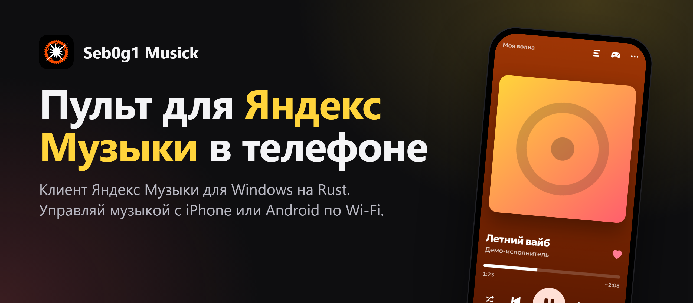
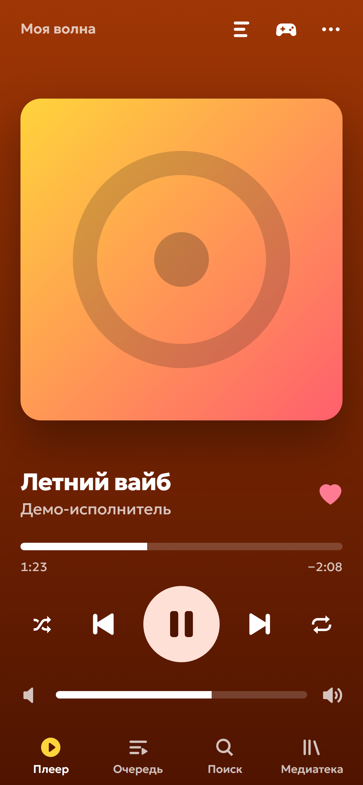
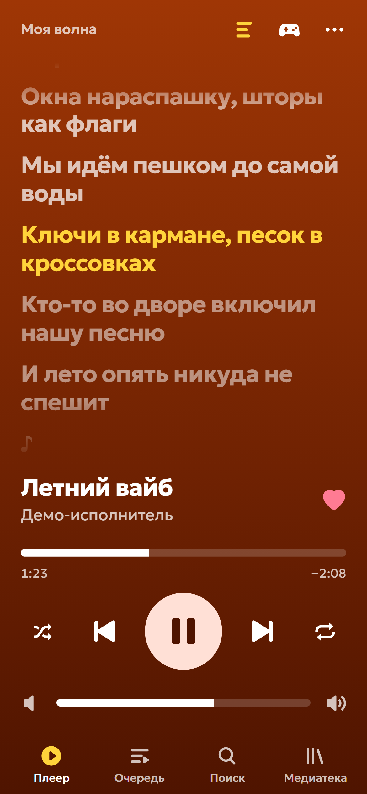
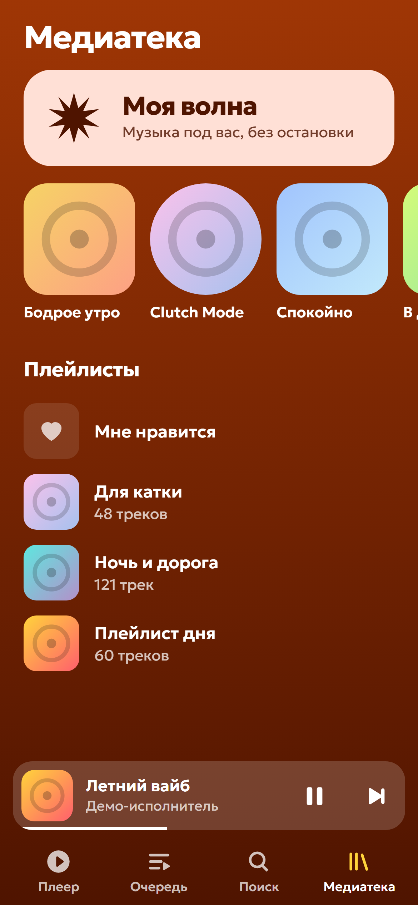
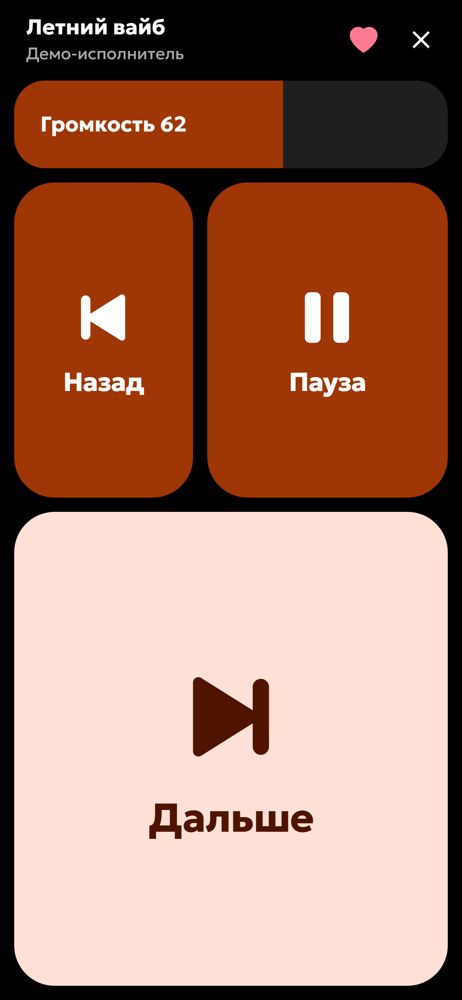
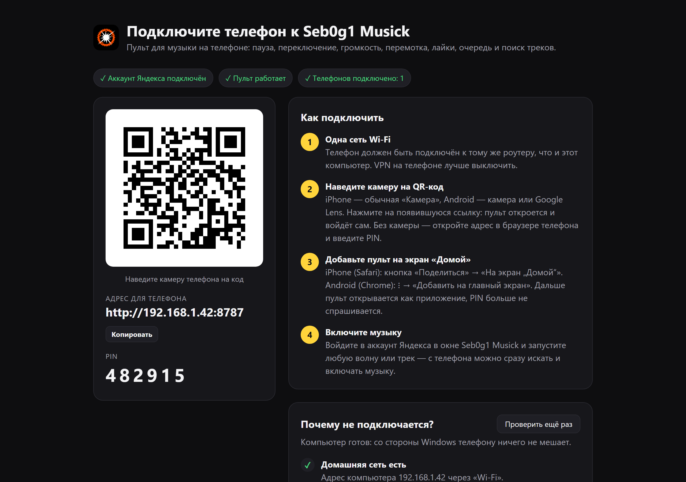

<div align="center">



# Seb0g1 Musick

**Yandex Music on your PC, the remote in your phone.**<br>
Pause, skip, volume, seek, likes, queue and search from an iPhone or Android over Wi-Fi — without leaving your game.

[](https://github.com/Seb0g1/Seb0g1-Music/releases/latest)
<br>
<a href="https://www.donationalerts.com/r/sebog"></a>
<br>
[](https://www.twitch.tv/seb0g1)
[](https://sebog1.ru)
[](https://shop.sebog1.ru)
<br>


[](LICENSE)
[](https://www.virustotal.com/gui/file/c22525357f15a98e925eaab322ab79c388529a1da761afde31b47ca1b294cb12/detection)

[Русский](README.md) · **English**

</div>

---

## Why

Spotify lets you skip a song on your computer from your phone. The Yandex Music desktop app does not: to pause or skip you have to alt-tab out of your game.

**Seb0g1 Musick** fixes that. It is a Yandex Music client for Windows written in Rust that serves a tiny remote on your home network. Your phone opens it in the browser by scanning a QR code — no App Store or Google Play install. The interface is in Russian.

<div align="center">

&nbsp;

&nbsp;

&nbsp;

</div>

## ⬇️ Download and install

1. Open **[Releases](https://github.com/Seb0g1/Seb0g1-Music/releases/latest)** and download `Seb0g1-Musick-Setup-….exe`.
2. Run the installer. Keep **"Allow phone connection over Wi-Fi"** checked — it adds a Windows Firewall rule for private networks.
3. Start Seb0g1 Musick and sign in with your Yandex account. Full-length tracks need Yandex Plus, as in the official app.

> Windows SmartScreen may warn that the installer is unsigned. Click **"More info" → "Run anyway"**.

🛡 **Virus scan:** [VirusTotal report](https://www.virustotal.com/gui/file/c22525357f15a98e925eaab322ab79c388529a1da761afde31b47ca1b294cb12/detection) for installer 1.2.0.<br>
SHA-256: `c22525357f15a98e925eaab322ab79c388529a1da761afde31b47ca1b294cb12`<br>
Verify locally: `Get-FileHash .\Seb0g1-Musick-Setup-1.2.0.exe` in PowerShell.

Requirements: Windows 10 or 11, 64-bit. Any phone with a browser: iPhone (Safari), Android (Chrome).

## 📱 Connect your phone

On first launch the app opens the **"Connect a phone"** page by itself. Later you can open it from the tray icon → **"Подключить телефон…"** (Connect phone).

<div align="center">

</div>

1. Phone and PC on **the same Wi-Fi** (same router).
2. **Point the phone camera at the QR code** and tap the link. The remote opens and signs in by itself. No camera? Open the `http://192.168.x.x:8787` address and type the PIN shown on the page.
3. **Add the remote to the home screen** to use it like an app:
   - iPhone (Safari): Share → "Add to Home Screen";
   - Android (Chrome): ⋮ → "Add to Home screen".

The PIN is asked only once: after that the phone is recognised by its own key, even after a PC restart.

## 🎛 What the remote does

| | |
|---|---|
| ⏯ **Play, pause, skip, seek, volume** | large buttons and sliders you can drag anywhere |
| 👆 **Gesture cover** | swipe sideways to change the track, up and down for volume, double-tap to like |
| 🎮 **Match mode** | huge Next, Pause and Back buttons you can hit without looking |
| 🎤 **Lyrics** | lines follow the music, tap a line to jump to it |
| 📚 **Library** | My Wave, moods, "My likes" and playlists |
| 🔎 **Search** | results as you type; play, "play next" or "add to queue" |
| 📋 **Queue** | next 30 tracks, tap to jump |
| 🔀 **Shuffle and repeat** | same as in the desktop window |
| 😴 **Sleep timer** | stops the music in 15, 30, 60 or 90 minutes |
| ❤️ **Like and dislike** | plus a wave based on the current track |
| 🖥 **Desktop and tablet** | player and section side by side, keyboard control |

Everything else is a full Yandex Music client: My Wave, playlists, albums, artists, lyrics, equalizer, media keys, tray. It is based on [yamusic-rs](https://github.com/SpolzerMod/yamusic-rs) — see [docs/UPSTREAM-README.md](docs/UPSTREAM-README.md) for the client itself.

## ⚡ Load on the PC

The remote is built not to get in the way of games:

- the server sleeps while no phone is connected — **0 % CPU**;
- the phone keeps **one long-poll request**, the PC answers only when the track, pause, volume, like or queue changes; the phone computes the position itself;
- when the phone screen turns off, the remote stops contacting the PC;
- no GPU use.

Measured on a 16-core PC while music plays, whole app:

| Mode | CPU | Memory |
|---|---|---|
| No phone connected | 0.11 % | ~100 MB |
| Remote open on the phone | 0.16 % | +0.3 MB |

## 🔒 Security

- The remote server is reachable **only from your home network**; it cannot be reached from the internet and publishes nothing outside.
- Sign-in with a **6-digit PIN**. After 10 wrong attempts in 10 minutes sign-in is locked; every wrong attempt is slowed down.
- After sign-in the phone gets a **random 64-character key**; the PC stores only its SHA-256 hash.
- The page with the QR code and PIN opens **only on the PC itself** (`127.0.0.1`); other devices get `403`.
- The installer's firewall rule applies to **private** networks only, so the remote stays closed on café and other public networks.
- Lost a phone? "Connect a phone" page → **"Disconnect all phones and change PIN"**.
- Turn the remote off completely: `%APPDATA%\yamusic-rs\remote.json` → `"enabled": false`.

## ❓ FAQ

<details>
<summary><b>The phone cannot open the address</b></summary>

- The Windows network must be **Private**: Settings → Network & Internet → Wi-Fi (or Ethernet) → your network → "Network profile type: Private".
- Phone and PC must be on the same network. A router's guest network usually isolates devices.
- Turn off VPN on the phone.
- The address may have changed after a router reboot — open "Connect phone" again.
- An antivirus firewall may block port `8787` — allow Seb0g1 Musick there.
</details>

<details>
<summary><b>The connect page shows the wrong address</b></summary>

The app picks the Wi-Fi or Ethernet adapter with a gateway and skips virtual adapters (VPN, Hyper-V, WSL, VirtualBox, Docker). Other addresses are listed below the main one — try them.
</details>

<details>
<summary><b>Several phones?</b></summary>

Yes, connect each one by QR code. Up to 20 phones are remembered.
</details>

<details>
<summary><b>Without Yandex Plus?</b></summary>

It works, but as in the official app, Yandex serves only 30-second previews without Plus.
</details>

## 🛠 Build from source

Requires [Rust](https://rustup.rs) 1.92+ and Visual Studio Build Tools with "Desktop development with C++".

```powershell
git clone https://github.com/Seb0g1/Seb0g1-Music.git
cd Seb0g1-Music
cargo build --release
# exe: target\release\yamusic-rs.exe
```

The installer is built with [Inno Setup 6](https://jrsoftware.org/isinfo.php):

```powershell
& "$env:LOCALAPPDATA\Programs\Inno Setup 6\ISCC.exe" packaging\windows\seb0g1-musick.iss
# output: dist\Seb0g1-Musick-Setup-<version>.exe
```

### What is added on top of yamusic-rs

| File | Purpose |
|---|---|
| [`src/remote.rs`](src/remote.rs) | remote HTTP server: PIN, device keys, long-poll, search, connect page, QR code, address picked from network adapters |
| [`src/netdiag.rs`](src/netdiag.rs) | "Why won't it connect?": network and firewall check with a Fix button |
| [`src/update.rs`](src/update.rs) | one-click updates through the release installer |
| [`src/remote_page.html`](src/remote_page.html) | the phone remote (Geologica font, SIL OFL 1.1) |
| [`src/remote_setup.html`](src/remote_setup.html) | "Connect a phone" page on the PC |
| [`src/gui.rs`](src/gui.rs), [`src/tray.rs`](src/tray.rs) | remote commands through the app window, tray item |
| [`packaging/windows/`](packaging/windows) | installer and guide |
| [`tools/screenshots.py`](tools/screenshots.py) | README screenshots on demo data |

## 💛 Support the author and order development

Seb0g1 Musick is free and will stay free. If the remote saved you a couple of lost rounds, support the author:

<p align="center"><a href="https://www.donationalerts.com/r/sebog"></a></p>

| | |
|---|---|
| 💸 **Donate** | [donationalerts.com/r/sebog](https://www.donationalerts.com/r/sebog) |
| 🎮 **Twitch streams** | [twitch.tv/seb0g1](https://www.twitch.tv/seb0g1) |
| 🧑‍💻 **Portfolio** | [sebog1.ru](https://sebog1.ru) |
| 🛒 **Order development** | [shop.sebog1.ru](https://shop.sebog1.ru) — websites, bots, apps and custom work |

## 📄 License and credits

Seb0g1 Musick is a fork of **[yamusic-rs](https://github.com/SpolzerMod/yamusic-rs)** by [SpolzerMod](https://github.com/SpolzerMod) — thanks for a great client. Licensed under the same **[GPL-3.0](LICENSE)**: the source is open, you may study, change and share it under the same terms.

Unofficial client, not affiliated with Yandex LLC. "Yandex Music" is a trademark of Yandex LLC. A Yandex account is required to listen.
