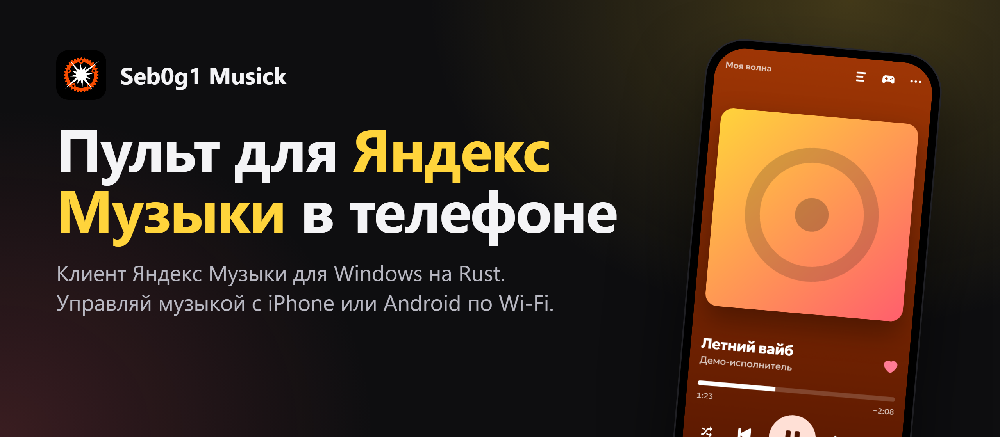
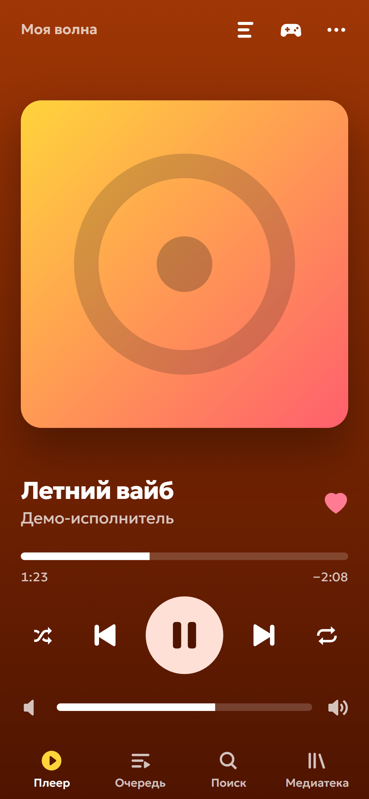
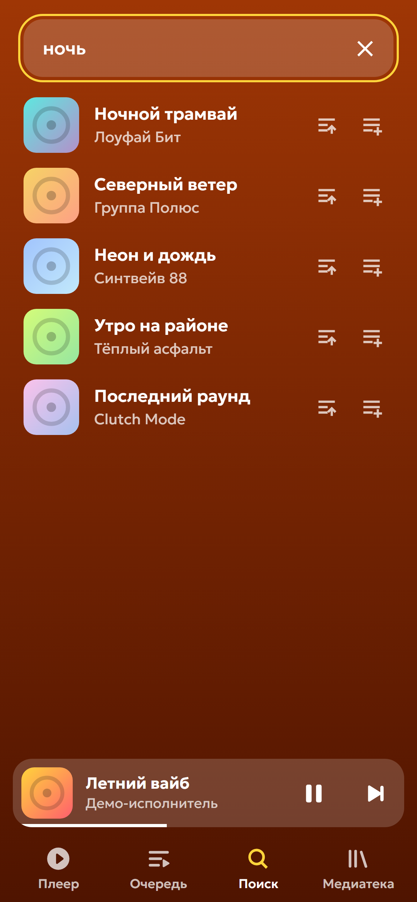
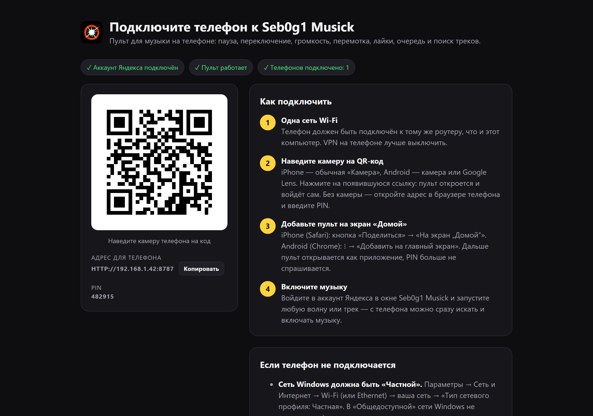

<div align="center">



# Seb0g1 Musick

**Яндекс Музыка на компьютере, а пульт — в телефоне.**<br>
Пауза, треки, громкость, перемотка, лайки, очередь и поиск с iPhone или Android по Wi-Fi — не сворачивая игру.

[](https://github.com/Seb0g1/Seb0g1-Music/releases/latest)
<br>


[](LICENSE)
[](https://www.virustotal.com/gui/file/b54ee56b4cca20b9f94e0cb6abb8110fb369209d295470ad0023439454166d02/detection)

**Русский** · [English](README.en.md)

[Скачать](#-скачать-и-установить) ·
[Подключить телефон](#-подключить-телефон) ·
[Возможности](#-что-умеет-пульт) ·
[Нагрузка](#-нагрузка-на-пк) ·
[Безопасность](#-безопасность) ·
[Вопросы](#-частые-вопросы) ·
[Сборка](#-сборка-из-исходников)

</div>

---

## Зачем

В Spotify можно переключить трек на компьютере прямо с телефона. В Яндекс Музыке для ПК — нельзя: чтобы поставить паузу или пропустить песню, надо сворачивать игру.

**Seb0g1 Musick** это исправляет. Это клиент Яндекс Музыки для Windows на Rust, и он поднимает в домашней сети маленький пульт. Телефон открывает его в браузере по QR-коду — ставить приложения из App Store или Google Play не нужно.

<div align="center">

&nbsp;&nbsp;&nbsp;

</div>

## ⬇️ Скачать и установить

1. Откройте **[Releases](https://github.com/Seb0g1/Seb0g1-Music/releases/latest)** и скачайте `Seb0g1-Musick-Setup-….exe`.
2. Запустите установщик. Оставьте галочку **«Разрешить подключение телефона по Wi-Fi»** — она добавит правило брандмауэра для частных сетей.
3. Запустите Seb0g1 Musick и войдите в аккаунт Яндекса. Для полных треков нужна подписка Плюс — как и в официальном приложении.

> Windows может показать «Windows защитила компьютер» — установщик не подписан сертификатом. Нажмите **«Подробнее» → «Выполнить в любом случае»**.

🛡 **Проверка на вирусы:** [отчёт VirusTotal](https://www.virustotal.com/gui/file/b54ee56b4cca20b9f94e0cb6abb8110fb369209d295470ad0023439454166d02/detection) для установщика 1.1.5.2.<br>
SHA-256: `b54ee56b4cca20b9f94e0cb6abb8110fb369209d295470ad0023439454166d02`<br>
Сверить у себя: `Get-FileHash .\Seb0g1-Musick-Setup-1.1.5.2.exe` в PowerShell.

Системные требования: Windows 10 или 11, 64 бит. Телефон — любой с браузером: iPhone (Safari), Android (Chrome).

## 📱 Подключить телефон

При первом запуске программа сама откроет страницу **«Подключить телефон»**. Позже её можно открыть из трея: правый клик по значку → **«Подключить телефон…»**.

<div align="center">

</div>

1. Телефон и компьютер — **в одной сети Wi-Fi** (один роутер).
2. **Наведите камеру телефона на QR-код** и нажмите на ссылку. Пульт откроется и войдёт сам. Без камеры — откройте адрес вида `http://192.168.x.x:8787` и введите PIN со страницы.
3. **Добавьте пульт на экран «Домой»**, чтобы открывать его как приложение:
   - iPhone (Safari): «Поделиться» → «На экран „Домой“»;
   - Android (Chrome): ⋮ → «Добавить на главный экран».

PIN спрашивается только один раз: дальше телефон узнаётся по своему ключу, даже после перезапуска ПК.

## 🎛 Что умеет пульт

| | |
|---|---|
| ⏯ **Пауза и треки** | назад, пауза, вперёд — мгновенно |
| 🔊 **Громкость** | ползунок, синхронизирован с окном программы |
| ⏩ **Перемотка** | ползунок времени трека |
| ❤️ **Лайк** | «Мне нравится» текущему треку |
| 📋 **Очередь** | 30 следующих треков, нажмите — переключится |
| 🔎 **Поиск** | найти трек, включить сразу, «играть следующим» или «в конец очереди» |
| 🖼 **Обложка и время** | видно, что играет, и сколько осталось |

Всё остальное — это полноценный клиент Яндекс Музыки: Моя волна, плейлисты, альбомы, исполнители, тексты, эквалайзер, медиаклавиши, трей. Он основан на [yamusic-rs](https://github.com/SpolzerMod/yamusic-rs) — подробности о самом клиенте в [docs/UPSTREAM-README.md](docs/UPSTREAM-README.md).

## ⚡ Нагрузка на ПК

Пульт сделан так, чтобы не мешать играм:

- сервер спит, пока телефон не подключён, — **0 % процессора**;
- телефон держит **один долгий запрос**, и компьютер отвечает только когда меняется трек, пауза, громкость, лайк или очередь; позицию трека телефон считает сам;
- когда экран телефона гаснет, пульт перестаёт обращаться к ПК;
- видеокарта не используется.

Замер на 16-ядерном ПК, пока играет музыка, — вся программа целиком:

| Режим | Процессор | Память |
|---|---|---|
| Телефон не подключён | 0,11 % | ~100 МБ |
| Пульт открыт на телефоне | 0,16 % | +0,3 МБ |

## 🔒 Безопасность

- Сервер пульта доступен **только из домашней сети**: из интернета к нему не подключиться, наружу он ничего не публикует.
- Вход — по **PIN из 6 цифр**. После 10 неверных попыток за 10 минут вход закрывается; каждая ошибка тормозит ответ.
- После входа телефон получает **случайный ключ из 64 символов**; на компьютере хранится только его хеш SHA-256.
- Страница с QR-кодом и PIN открывается **только на самом компьютере** (`127.0.0.1`), с других устройств — `403`.
- Правило брандмауэра из установщика действует только в **частных** сетях. В кафе и других общедоступных сетях пульт закрыт.
- Потеряли телефон? Страница «Подключить телефон» → **«Отключить все телефоны и сменить PIN»**.
- Пульт можно выключить совсем: `%APPDATA%\yamusic-rs\remote.json` → `"enabled": false`.

## ❓ Частые вопросы

<details>
<summary><b>Телефон не открывает адрес</b></summary>

- Сеть Windows должна быть **«Частной»**: Параметры → Сеть и Интернет → Wi-Fi (или Ethernet) → ваша сеть → «Тип сетевого профиля: Частная».
- Телефон и ПК должны быть в одной сети. Гостевая сеть роутера обычно не даёт устройствам видеть друг друга.
- Выключите VPN на телефоне.
- Адрес мог смениться после перезагрузки роутера — откройте «Подключить телефон…» снова.
- Антивирус с сетевым экраном может закрывать порт `8787` — разрешите в нём Seb0g1 Musick.
</details>

<details>
<summary><b>На странице подключения не тот адрес</b></summary>

Программа выбирает Wi-Fi или Ethernet со шлюзом и пропускает виртуальные адаптеры (VPN, Hyper-V, WSL, VirtualBox, Docker). Если ваш случай особый — ниже основного адреса показаны остальные, попробуйте их.
</details>

<details>
<summary><b>Можно ли управлять с нескольких телефонов?</b></summary>

Да, подключите каждый по QR-коду. Программа помнит до 20 телефонов.
</details>

<details>
<summary><b>Работает ли без подписки Плюс?</b></summary>

Да, но, как и в официальном приложении, без Плюса Яндекс отдаёт только 30-секундные отрывки.
</details>

<details>
<summary><b>Почему Windows ругается на установщик?</b></summary>

Установщик не подписан платным сертификатом разработчика. Проверьте его на [VirusTotal](https://www.virustotal.com/gui/file/b54ee56b4cca20b9f94e0cb6abb8110fb369209d295470ad0023439454166d02/detection) — или соберите сами из открытого кода (ниже).
</details>

<details>
<summary><b>Как сменить порт?</b></summary>

`%APPDATA%\yamusic-rs\remote.json` → `"port"`, затем перезапустите программу. Правило брандмауэра из установщика открывает только `8787`.
</details>

## 🛠 Сборка из исходников

Нужны [Rust](https://rustup.rs) 1.92+ и Visual Studio Build Tools с компонентом «Разработка классических приложений на C++».

```powershell
git clone https://github.com/Seb0g1/Seb0g1-Music.git
cd Seb0g1-Music
cargo build --release
# exe: target\release\yamusic-rs.exe
```

Установщик собирается [Inno Setup 6](https://jrsoftware.org/isinfo.php):

```powershell
& "$env:LOCALAPPDATA\Programs\Inno Setup 6\ISCC.exe" packaging\windows\seb0g1-musick.iss
# результат: dist\Seb0g1-Musick-Setup-<версия>.exe
```

### Что добавлено поверх yamusic-rs

| Файл | Что делает |
|---|---|
| [`src/remote.rs`](src/remote.rs) | HTTP-сервер пульта: PIN, ключи устройств, долгий запрос, поиск, страница подключения, QR-код, выбор адреса по сетевым адаптерам |
| [`src/remote_page.html`](src/remote_page.html) | пульт на телефоне |
| [`src/remote_setup.html`](src/remote_setup.html) | страница «Подключить телефон» на ПК |
| [`src/gui.rs`](src/gui.rs), [`src/tray.rs`](src/tray.rs) | команды пульта через окно программы, пункт трея |
| [`packaging/windows/`](packaging/windows) | установщик и инструкция |
| [`tools/screenshots.py`](tools/screenshots.py) | скриншоты для README на демо-данных |

## 📄 Лицензия и авторство

Seb0g1 Musick — форк **[yamusic-rs](https://github.com/SpolzerMod/yamusic-rs)** от [SpolzerMod](https://github.com/SpolzerMod). Спасибо автору за отличный клиент. Распространяется по той же лицензии **[GPL-3.0](LICENSE)**: исходный код открыт, его можно изучать, менять и распространять на тех же условиях.

Неофициальный клиент. Проект не связан с ООО «Яндекс»; «Яндекс Музыка» — товарный знак ООО «Яндекс». Для прослушивания нужен ваш аккаунт Яндекса.
